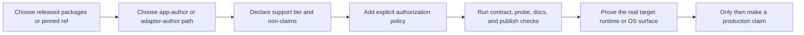

# Release policy (all hosted `intentcall_*` packages)

**Status:** The synchronized **pub.dev package train** is **semver 1.x** (released through Release Please and `.github/workflows/publish_train.yml`). Packages are contract-tested platform infrastructure — **not production-ready without app/runtime proof**.

## Semver

- **Breaking API or wire-contract changes require a new major** on the synchronized train, with a documented deprecation path in release notes and changelogs where feasible.
- **Minor and patch** releases add compatible behavior and fixes within the current major.
- The train version is defined by `.release-please-manifest.json`; all publishable `intentcall_*` packages move together.

## Integration expectations

- Standalone repo at [github.com/Arenukvern/intentcall](https://github.com/Arenukvern/intentcall) (sibling to `mcp_flutter` locally).
- Prefer **pub.dev** with normal semver constraints for apps; use **path** or **pinned git refs** for dogfood and pre-release verification.
- **Flutter MCP Toolkit** (`mcp_toolkit`) remains the supported product surface for app authors. IntentCall is the underlying platform extracted for multi-adapter work (MCP, WebMCP, native).

## Production claims

Package tests, adapter contract tests, and generated artifacts are necessary but **not sufficient** for a production claim. Declare platform support tier, authorization policy, and prove the target runtime or OS surface in the consuming app. See [platform support](docs/start_here/platform_support.mdx) and [roadmap — before a production claim](docs/start_here/roadmap.mdx).

We keep the filename **PRE_RELEASE.md** so existing links stay valid; the content describes **current 1.x release policy**, not a pre-1.0 train.